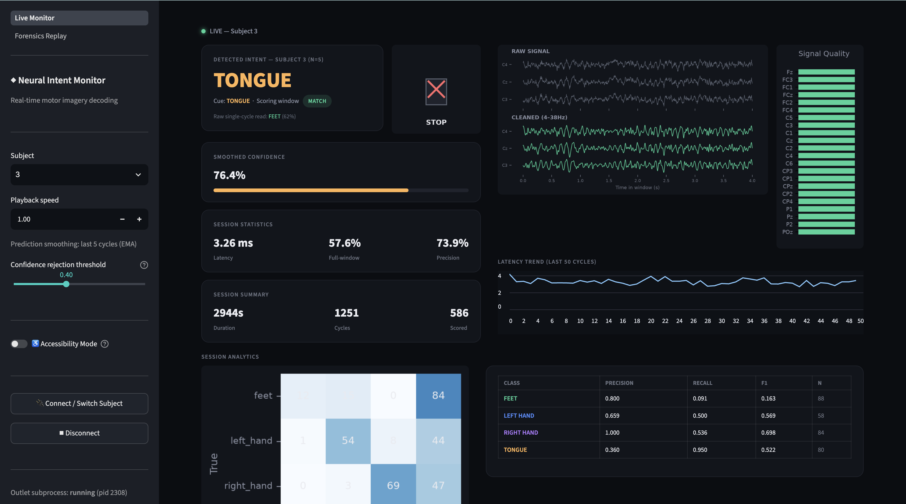
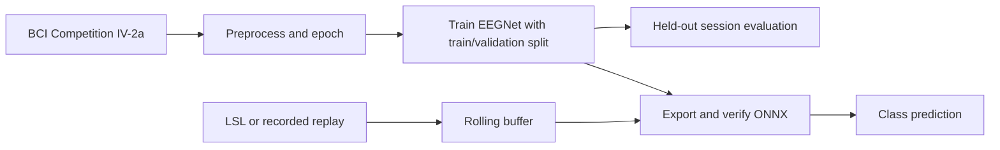

# Real-Time Motor Imagery BCI Pipeline

An EEGNet motor-imagery decoder that turns public BCI Competition IV-2a recordings into an LSL-capable, replayable, ONNX-exportable inference pipeline—with subject-level results and latency measured separately.

## Results

The results below are reported in the repository's corrected benchmark documentation, not reproduced in this review. Evaluation uses held-out session `1test`; a prior test-set checkpoint-selection leak was documented and corrected.

| Measurement | Reported result | Scope |
|---|---:|---|
| Offline accuracy, 9 subjects | **59.5% ± 16.9%** | Mean ± SD across subjects; four-class chance is 25% |
| ONNX Runtime CPU model compute | **0.29 ms mean / 0.32 ms P95** | Single trial, n=200; excludes the 4-second signal window required before a first decision |
| Subject 1 online replay | **63.8%** full-window; 60.5% precision-window | Replay evaluation; not a live clinical device |



## Architecture



## Quickstart and verification

The checked-in project does not currently have a clean install path: `requirements.txt` pins `pandas==2.2.2`, while `moabb==1.1.1` requires `pandas<2.0.0`. Installation stopped at this resolver conflict, so training and streaming commands were not verified in a fresh environment. Resolve and lock compatible dependencies before advertising a one-command run.

After installing a compatible environment and obtaining BCI Competition IV-2a data through MOABB, the intended entry points are:

```bash
python src/training/train.py
python src/export/export_onnx.py
```

Confirm these paths against the current branch before running; this review verified the dependency conflict, not these commands.

## Limitations

- Per-subject scores vary substantially; subjects 2 and 5 are near chance.
- ONNX timings are model-compute latency only. Four seconds of buffering dominates first-decision delay.
- The real-time path has a known offline/online filtering mismatch; causal stateful filtering is not implemented.
- Results are from public recordings and replay, not independent headset testing.

## Next steps

1. Fix dependency pins and add a clean-install CI job.
2. Add tests for ONNX/PyTorch equivalence, filters, and scoring windows.
3. Implement causal stateful filtering and report its measured online effect.
4. Add a CSP/LDA baseline and leave-one-subject-out evaluation.
